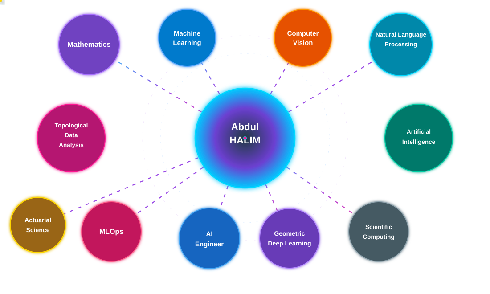

<!-- ============================================================
     ABDUL HALIM | GITHUB PROFILE
     Mathematics × AI × Scientific Computing
     Professional Animated Portfolio
     ============================================================ -->

<!-- ANIMATED GRADIENT HEADER -->

<!-- ANIMATED HANDWRITTEN SIGNATURE -->

<!-- ANIMATED TYPING INTRODUCTION -->

 

### 📐 Mathematics × 🔬 Scientific Computing × 🧠 Artificial Intelligence

*Connecting rigorous mathematical foundations with intelligent computational systems.*

 

</a>

<!-- PROFESSIONAL CONTACT BADGES -->

  

# 🌐 Let's Connect!

  

---

# 👨‍💻 About Me

I am **Abdul Halim**, with a strong academic background in **Mathematics** and extensive job experience in **university-level mathematics teaching as tutor**.

My work and research interests lie at the intersection of **Mathematics, Artificial Intelligence, Machine Learning, Computer Vision, Scientific Computing, and Topological Data Analysis**.

I focus on translating mathematical theory into efficient algorithms, computational models, reproducible experiments, and practical intelligent systems.

---

# 🔬 Research & Technical Interests

 

| 📐 Mathematics & Scientific Computing | 🧠 AI & Data Science | ☁️ Data & Infrastructure |
|:---|:---|:---|
| Mathematical Analysis | Machine Learning | Topological Data Analytics |
| Differential Geometry | Deep Learning | Business Intelligence |
| Algebra & Optimization | Geometric Deep Learning | Data Engineering |
| Partial Differential Equations | Explainable AI | Cloud Computing |
| Numerical Mathematics | Computer Vision | AWS & Microsoft Azure |
| Mathematical Modelling | Image Processing | MLOps |
| Numerical Linear Algebra | 3D Vision & Point Clouds | Big Data Management |
| Scientific Programming | Statistical Learning | Cloud Computing |
| Computational Experiments | Graph Machine Learning | Model Deployment |

---

# 🛠️ Technical Expertise

### 💻 Programming Languages

 

 

### 🧠 Artificial Intelligence & Machine Learning

 

 

### 👁️ Computer Vision

 

 

### 📊 Data Analytics & Business Intelligence

 

 

### ☁️ Cloud Computing & AI Engineering

 

 

### ⚙️ Development & MLOps

---

# 📊 GitHub Analytics

  

---

# 📊 GitHub Contributions & Activity

<picture>
  <source
    media="(prefers-color-scheme: dark)"
    srcset="https://raw.githubusercontent.com/halim-abdul/halim-abdul/output/github-contribution-grid-snake-dark.svg"
  />
  <source
    media="(prefers-color-scheme: light)"
    srcset="https://raw.githubusercontent.com/halim-abdul/halim-abdul/output/github-contribution-grid-snake.svg"
  />
  
</picture>

---

# 🤝 Project Collaboration

Throughout my academic and professional journey, I have collaborated on educational, mathematical, scientific-computing, and research-oriented projects.

My contributions include:

**Mathematical Modelling · Algorithms · Scientific Computing · Numerical Experiments · Topological Data Analysis · Data Science · Problem-Solving**

### 👥 Collaborators

| | | |
|:---:|:---:|:---:|
| Mr. Imran | Mr. Shibli | Mr. Abdullah |
| Mr. Nallani | Mr. Tosin | Mr. Verma |
| Mr. Athanasios | Mr. Avellas | Mr. Heere |
| Mr. Rahman | Mr. Mehmood | Ms. Kirli |
| Mr. Miguel | Ms. Alessia | Mr. Griebler |
| Mr. Jaguszewski | Ms. Szlachetka | Mr. Vinagre |
| Mr. Berdych | Mr. Galanciak | Mr. Krawiarz |
| Mr. Hernández | Mr. Banaś | Mr. Karim |

> **Note:** Their inclusion does not imply participation in every project or repository. Some projects remain private.

---

*"Wir müssen wissen. Wir werden wissen."- Hilbert.*

 

<!-- ORIGINAL ANIMATED WAVING FOOTER — RESTORED -->

 

<!-- TYPING GOODBYE ANIMATION -->

  

<!-- WAVING GRADIENT FOOTER -->

